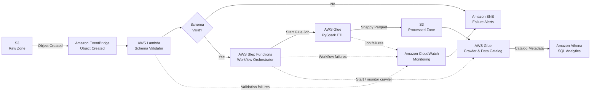

# Serverless E-Commerce Data Lake & ETL Pipeline

A Terraform-managed, event-driven AWS data lake and ETL pipeline for ingesting, validating, transforming, and querying e-commerce transaction data.

The pipeline uses **Amazon S3, EventBridge, Lambda, Step Functions, AWS Glue, PySpark, Athena, CloudWatch, and SNS** to create an automated serverless data workflow with pre-flight data validation, distributed transformation, Parquet storage, and operational monitoring.

## Architecture



### Data Flow

1. **Raw ingestion — S3**
   Raw e-commerce CSV files are uploaded to the S3 Raw Zone.

2. **Event detection — EventBridge**
   An S3 Object Created event triggers the pipeline automatically through Amazon EventBridge.

3. **Pre-flight validation — Lambda**
   A lightweight Python Lambda function reads the uploaded file header and validates required columns such as `quantity` and `customerid`. Validation is performed before starting the downstream Glue workload.

4. **Workflow orchestration — Step Functions**
   Valid files are passed to AWS Step Functions, which coordinates the ETL workflow, including Glue job execution and cataloging.

5. **Transformation — AWS Glue / PySpark**
   The Glue Spark job cleans and transforms the source data, including filtering invalid quantities and adding ingestion metadata.

6. **Optimized storage — S3 / Parquet**
   Transformed records are written to the S3 Processed Zone in Snappy-compressed Parquet format.

7. **Cataloging — Glue Crawler**
   The crawler discovers the processed dataset structure and updates the AWS Glue Data Catalog.

8. **Analytics — Athena**
   Amazon Athena queries the cataloged Parquet dataset directly in S3.

9. **Monitoring — CloudWatch / SNS**
   CloudWatch monitors pipeline failures and validation events, with SNS providing email notifications for configured alarms.

## Technology Stack

| Component              | Technology              | Purpose                                 |
| ---------------------- | ----------------------- | --------------------------------------- |
| Infrastructure as Code | Terraform               | Provision and manage AWS infrastructure |
| Object Storage         | Amazon S3               | Raw and processed data storage          |
| Event Routing          | Amazon EventBridge      | Trigger pipeline on new S3 objects      |
| Validation             | AWS Lambda / Python     | Pre-flight schema validation            |
| Orchestration          | AWS Step Functions      | Coordinate ETL workflow                 |
| Distributed Compute    | AWS Glue / PySpark      | Data transformation                     |
| Data Format            | Apache Parquet / Snappy | Columnar storage and compression        |
| Metadata               | AWS Glue Data Catalog   | Dataset and schema metadata             |
| Query Engine           | Amazon Athena           | Serverless SQL analytics                |
| Monitoring             | Amazon CloudWatch       | Pipeline monitoring and alarms          |
| Alerting               | Amazon SNS              | Failure and validation notifications    |

## Key Engineering Decisions

### Pre-Flight Schema Validation

The Lambda validator acts as a lightweight data contract gate before distributed processing begins.

It:

* Reads the uploaded file header using a lightweight S3 byte-range request.
* Performs case-insensitive validation of required columns.
* Prevents malformed files from proceeding to the Glue workload.
* Separates inexpensive validation from more expensive distributed processing.

This allows invalid inputs to be rejected before the ETL stage rather than discovering schema problems after Spark execution begins.

### Event-Driven Orchestration

The pipeline does not depend on a continuously running server or scheduled polling process.

The workflow is triggered by an S3 object event:

**S3 → EventBridge → Lambda → Step Functions → Glue**

Step Functions coordinates the downstream execution and handles workflow state, retries, and crawler monitoring.

### Parquet-Based Data Lake

The processed dataset is stored as Snappy-compressed Parquet rather than CSV.

Parquet provides:

* Columnar storage
* Compression
* Efficient analytical reads
* Predicate/column-based scanning
* Better compatibility with Athena and Spark workloads

This reduces the amount of data Athena needs to scan compared with querying raw CSV files in many analytical workloads.

### Dynamic Partitioning

The Glue transformation uses ingestion-date partitioning:

```text
ingestion_date=YYYY-MM-DD/
```

The Spark job uses dynamic partition overwrite behavior so that individual ingestion-date partitions can be updated without unnecessarily rewriting the entire processed dataset.

## Data Quality & Validation

The pipeline performs validation at multiple stages.

### Pre-Flight Validation

Lambda checks the incoming file schema before allowing the ETL workflow to proceed.

Required fields include:

| Column       | Requirement |
| ------------ | ----------- |
| `customerid` | Required    |
| `quantity`   | Required    |

Column matching is case-insensitive.

### Transformation Validation

The Glue job applies data cleansing rules during transformation, including filtering invalid transaction quantities.

### Operational Monitoring

CloudWatch monitors workflow and processing failures, while SNS provides notification delivery for configured alarms.

This creates separate visibility into:

* Input validation failures
* Step Functions failures
* Glue processing failures

## Input Data Schema

The pipeline expects CSV transaction files containing at least the following fields:

| Column       | Data Type        | Description                                                               |
| ------------ | ---------------- | ------------------------------------------------------------------------- |
| `customerid` | String / Integer | Customer identifier                                                       |
| `quantity`   | Integer          | Number of items purchased                                                 |
| Other fields | Various          | Additional transaction attributes such as price, timestamp, or product ID |

The Lambda validator only requires the minimum required columns, allowing additional fields to pass through to the transformation stage.

## Infrastructure as Code

The entire AWS environment is provisioned through Terraform.

```text
ecommerce-serverless-pipeline/
├── infrastructure/
│   ├── main.tf
│   ├── glue.tf
│   ├── lambda.tf
│   ├── iam.tf
│   ├── monitoring.tf
│   ├── outputs.tf
│   └── variables.tf
│
├── src/
│   ├── validator_lambda.py
│   └── glue_job.py
│
├── .gitignore
└── README.md
```

### Terraform Components

* S3 raw and processed zones
* EventBridge event routing
* Lambda validation function
* Step Functions state machine
* Glue database and crawler
* Glue ETL job
* IAM execution roles and policies
* Athena workgroup
* CloudWatch alarms
* SNS notifications

## Security

The infrastructure uses dedicated IAM roles and resource-scoped permissions for pipeline components.

The architecture separates:

* S3 storage permissions
* Lambda execution permissions
* Glue execution permissions
* Step Functions execution permissions
* Monitoring and notification permissions

Sensitive Terraform state, credentials, and local configuration files are excluded through `.gitignore`.

## Project Structure

### `infrastructure/`

Contains the Terraform configuration responsible for provisioning the AWS environment.

### `src/validator_lambda.py`

Contains the Lambda pre-flight validation logic.

### `src/glue_job.py`

Contains the PySpark transformation logic executed by AWS Glue.

## Deployment

### 1. Clone the repository

```bash
git clone https://github.com/YOUR_USERNAME/ecommerce-serverless-pipeline.git
cd ecommerce-serverless-pipeline/infrastructure
```

### 2. Initialize Terraform

```bash
terraform init
```

### 3. Review the infrastructure plan

```bash
terraform plan
```

### 4. Deploy

```bash
terraform apply
```

## Validation

After deployment, the pipeline can be validated by uploading test CSV files to the S3 Raw Zone.

### Valid Input

A CSV containing the required fields should follow the path:

```text
S3
 ↓
EventBridge
 ↓
Lambda validation
 ↓
Step Functions
 ↓
Glue PySpark
 ↓
S3 Parquet
 ↓
Glue Crawler
 ↓
Athena
```

### Invalid Input

A CSV missing a required field should be rejected by the Lambda validation stage and should not proceed to the Glue transformation workload.

## Engineering Highlights

* **Event-driven ETL:** S3 object events automatically initiate the pipeline.
* **Pre-flight data validation:** Invalid schemas are rejected before distributed processing.
* **Serverless architecture:** S3, Lambda, Step Functions, Glue, and Athena provide managed/serverless infrastructure.
* **Distributed transformation:** PySpark processes the transaction dataset using AWS Glue.
* **Optimized storage:** Processed data is stored as Snappy-compressed Parquet.
* **Dynamic partitioning:** Ingestion-date partitions can be updated independently.
* **Infrastructure as Code:** AWS infrastructure is reproducibly provisioned through Terraform.
* **Operational monitoring:** CloudWatch and SNS provide failure detection and notifications.

## Production Considerations

This project is designed as a portfolio implementation demonstrating production-oriented AWS data engineering patterns. A larger production deployment could further incorporate:

* AWS Lake Formation governance
* KMS customer-managed encryption keys
* CI/CD for Terraform and ETL code
* Data-quality frameworks such as Great Expectations or Deequ
* Centralized logging and observability
* Schema versioning and data contracts
* VPC-based networking where required
* Additional retry and dead-letter handling
* Cost and performance monitoring

## What This Project Demonstrates

This project demonstrates practical experience designing and implementing an automated AWS data pipeline rather than simply querying a static dataset.

The implementation covers the full lifecycle:

**Ingestion → Validation → Orchestration → Transformation → Storage → Cataloging → Analytics → Monitoring**

The infrastructure and application code are maintained separately, with Terraform managing the AWS environment and Python/PySpark implementing the data-processing logic.
