# Serverless E-Commerce Data Lake & ETL Pipeline

An event-driven, serverless data engineering platform built on AWS and provisioned with Terraform. The pipeline processes **110 million e-commerce behavioral event records** through automated ingestion, schema validation, distributed PySpark transformations, hierarchical date partitioning, and metadata discovery. Built with Amazon S3, AWS Glue, AWS Lambda, and AWS Step Functions, the platform delivers analytics-ready Parquet datasets for SQL querying through Amazon Athena.

The project demonstrates end-to-end data engineering practices, including infrastructure as code, event-driven pipeline orchestration, data quality controls, distributed processing, cloud security, and operational monitoring.

## Architecture & Data Flow

```mermaid
flowchart LR
    A[Kaggle Dataset / CSV Upload] --> B[S3 Raw Zone]
    B --> C[Amazon EventBridge]
    C --> D[Lambda Schema Validator]

    D -->|Valid Schema| E[AWS Step Functions]
    D -->|Validation Error| M[CloudWatch Logs & Alarms]

    E -->|Synchronous Execution| F[Amazon Glue PySpark ETL]
    F --> G[S3 Processed Zone]
    G --> H[Glue Crawler]
    H --> I[Glue Data Catalog]
    I --> J[Amazon Athena]

    E -->|Execution Failure| M
    M --> N[Amazon SNS Email Alerts]

    K[AWS Secrets Manager] --> L[Glue Python Shell Ingestion]
    L --> B

    style D fill:#FF9900,stroke:#232F3E,stroke-width:2px,color:#000
    style E fill:#232F3E,stroke:#FF9900,stroke-width:2px,color:#fff
    style F fill:#00A4E4,stroke:#232F3E,stroke-width:2px,color:#fff
    style J fill:#3F8624,stroke:#232F3E,stroke-width:2px,color:#fff
```



## Key Engineering Highlights

- **Large-scale data processing:** Processed approximately **110 million e-commerce behavioral event records** using AWS Glue and distributed PySpark transformations.
- **Event-driven orchestration:** Connected Amazon S3, EventBridge, Lambda, and Step Functions to automate the pipeline from file arrival through transformation and cataloging.
- **Data quality validation:** Implemented a pre-processing schema validation gate to prevent files missing required columns from triggering distributed ETL workloads.
- **Analytics-optimized storage:** Wrote transformed data to date-partitioned Apache Parquet datasets to support columnar reads and partition pruning in Amazon Athena.
- **Infrastructure as code:** Provisioned AWS resources, IAM roles, workflow orchestration, and monitoring using Terraform.
- **Operational monitoring:** Configured CloudWatch metric alarms and Amazon SNS email notifications for selected Lambda and Step Functions failures.
- **Secure ingestion:** Retrieved Kaggle API credentials from AWS Secrets Manager rather than hardcoding credentials in application code.

## Architecture & Data Flow Details

### 1. Data Ingestion — Amazon S3, AWS Glue, and Kaggle API

**Source dataset:** [eCommerce behavior data from multi-category store — Kaggle](https://www.kaggle.com/datasets/mkechinov/ecommerce-behavior-data-from-multi-category-store)

The pipeline ingests two monthly CSV files containing e-commerce behavioral events collected by the Open CDP project:

- `2019-Oct.csv`
- `2019-Nov.csv`

A dedicated AWS Glue Python Shell job authenticates with the Kaggle API, downloads the dataset archive, and streams the selected CSV files directly from the ZIP archive into the S3 raw zone.

Kaggle credentials are retrieved from AWS Secrets Manager at runtime. Alternatively, CSV files can be uploaded directly to the raw S3 bucket to initiate the processing workflow.

### 2. Event-Driven Validation — Amazon EventBridge and AWS Lambda

An Amazon EventBridge rule detects S3 object-created events in the raw data bucket and invokes a Python 3.11 Lambda validator.

The validator:

- Extracts the source bucket and object key from the event payload.
- Retrieves the beginning of the uploaded object using an S3 byte-range request.
- Checks for the required `event_time`, `event_type`, `product_id`, and `user_id` columns using case-insensitive header matching.
- Raises an exception when the file is empty or required columns are missing.
- Starts the Step Functions workflow only after schema validation succeeds.

This validation gate helps prevent malformed input files from unnecessarily triggering distributed Spark workloads.

### 3. Workflow Orchestration — AWS Step Functions

AWS Step Functions coordinates the ETL workflow through AWS service integrations.

1. Starts the Glue ETL job with the source bucket, source object key, and destination path.
2. Waits synchronously for the Glue job to finish.
3. Starts the Glue crawler to discover and update the processed dataset's metadata.
4. Polls the crawler every 30 seconds while its state is `RUNNING` or `STOPPING`.
5. Completes the workflow when the crawler reaches a different state.

The Glue task includes retry configuration with exponential backoff to help recover from transient processing failures.

### 4. Distributed Transformation — AWS Glue and PySpark

The Glue ETL job reads the specified S3 CSV object and applies distributed data transformations using Apache Spark.

**Data cleansing and enrichment**

- Removes records with missing `user_id` or `product_id`.
- Filters negative prices when the `price` column is present.
- Derives an `interaction_score` from the event type:
  - `view` → 1
  - `cart` → 3
  - `purchase` → 5
  - Other event types, including `remove_from_cart` → 0
- Converts `event_time` into a timestamp when available.
- Derives `year`, `month`, and `day` partition columns from the event timestamp.
- Uses fallback partition values when `event_time` is unavailable.
- Writes transformed data to the S3 processed zone in append mode.

**Spark optimization**

- Enables Adaptive Query Execution (AQE).
- Enables adaptive partition coalescing.
- Configures a 128 MiB advisory partition size.
- Uses hierarchical date partitioning to support partition pruning in downstream analytical queries.

The job is configured to use dynamic partition overwrite semantics in Spark, but the current write operation uses append mode rather than overwrite mode.

### 5. Data Catalog and SQL Analytics — AWS Glue Data Catalog and Amazon Athena

After the transformation job completes, the Glue crawler scans the processed S3 dataset and updates the Glue Data Catalog database, `ecommerce_lake_v2`.

Amazon Athena uses the cataloged metadata to query the processed Parquet data directly in S3 without requiring a continuously running database server.

An Athena workgroup is configured with a dedicated S3 location for query results.

This separation of raw storage, transformed datasets, metadata, and analytical querying supports maintainable data lake architecture.

### 6. Monitoring and Alerting — Amazon CloudWatch and Amazon SNS

The infrastructure defines CloudWatch metric alarms for two operational failure signals:

- **Step Functions execution failures:** Monitors the `ExecutionsFailed` metric for the ETL state machine.
- **Lambda execution errors:** Monitors the `Errors` metric for the schema validator.

Amazon SNS sends email notifications when either configured alarm breaches its threshold. The alarms use `treat_missing_data = "notBreaching"` so that periods without metric data are not treated as failures.

## Technology Stack & Architecture Decisions

| Technology | Purpose |
|---|---|
| Terraform | Infrastructure as code and repeatable AWS provisioning |
| Amazon S3 | Raw data, processed data, scripts, and query-result storage |
| Amazon EventBridge | Event-driven detection of S3 object creation |
| AWS Lambda | Lightweight schema validation and workflow initiation |
| AWS Step Functions | ETL orchestration, retries, and crawler coordination |
| AWS Glue / PySpark | Distributed data transformation |
| AWS Glue Data Catalog | Table metadata and schema discovery |
| Amazon Athena | Serverless SQL analytics |
| AWS Secrets Manager | Secure Kaggle credential retrieval |
| Amazon CloudWatch | Logs and metric-based alarms |
| Amazon SNS | Email-based operational notifications |
| Python / boto3 | AWS service integration |
| Apache Parquet | Columnar storage for analytical workloads |

### Infrastructure as Code — Terraform

Terraform provisions the pipeline's AWS resources, IAM execution roles, storage layers, workflow orchestration, and monitoring. This makes infrastructure changes reviewable and repeatable.

### Distributed Compute — AWS Glue

AWS Glue provides managed Apache Spark execution for distributed data processing. The job uses G.1X workers, the Standard execution class, and Adaptive Query Execution settings.

### Storage Format — Apache Parquet

Parquet's columnar layout supports analytical workloads by allowing queries to read relevant columns instead of scanning every column in a CSV file. Combined with date partitioning, it can reduce Athena data scanned when queries filter on partition columns.

### Event-Driven Orchestration — AWS Step Functions

Step Functions coordinates validation-triggered processing, job completion, crawler execution, and retry behavior without a continuously running orchestration server.

### Security and Observability

Separate IAM roles are defined for the primary pipeline components, with resource-scoped permissions where configured. Secrets Manager protects the external API credentials, while CloudWatch and SNS provide visibility into selected operational failures.

## Dataset

The project uses the [eCommerce behavior data from multi-category store dataset on Kaggle](https://www.kaggle.com/datasets/mkechinov/ecommerce-behavior-data-from-multi-category-store), published by Open CDP.

The October and November 2019 datasets contain user interactions with products on a large multi-category online store. Each row represents a behavioral event.

| Column | Description |
|---|---|
| `event_time` | UTC timestamp when the event occurred |
| `event_type` | Interaction type: `view`, `cart`, `remove_from_cart`, or `purchase` |
| `product_id` | Product identifier |
| `category_id` | Product category identifier |
| `category_code` | Category name, when available |
| `brand` | Brand name, when available |
| `price` | Product price |
| `user_id` | Persistent user identifier |
| `user_session` | User session identifier |

## Project Structure

```text
ecommerce-serverless-pipeline/
├── infrastructure/
│   ├── main.tf              # AWS provider, S3 buckets, Athena workgroup
│   ├── glue.tf              # Glue database, crawler, jobs, and IAM
│   ├── lambda.tf            # Lambda validator and execution permissions
│   ├── iam.tf               # Step Functions and EventBridge configuration
│   ├── monitoring.tf        # CloudWatch alarms and SNS notifications
│   ├── outputs.tf           # Bucket names and state machine ARN
│   └── variables.tf         # Terraform variables
├── src/
│   ├── validator_lambda.py  # CSV schema validation
│   ├── glue_job.py          # PySpark transformation job
│   └── ingest_kaggle.py     # Kaggle dataset ingestion
├── .gitignore
└── README.md
```

## Deployment Instructions

### Prerequisites

- An AWS account with permissions to provision the required resources.
- AWS CLI configured with appropriate credentials.
- Terraform 1.5 or later.
- Valid Kaggle API credentials and access to the source dataset.

### 1. Clone the Repository

```bash
git clone https://github.com/YOUR_USERNAME/ecommerce-serverless-pipeline.git
cd ecommerce-serverless-pipeline/infrastructure
```

Replace `YOUR_USERNAME` with your GitHub username or organization.

### 2. Configure Kaggle Credentials

Create an AWS Secrets Manager secret in `us-east-1` named:

```text
ecommerce/kaggle/credentials
```

Store the credentials as JSON:

```json
{
  "KAGGLE_USERNAME": "your_kaggle_username",
  "KAGGLE_KEY": "your_kaggle_api_key"
}
```

Ensure the secret ARN matches the scope permitted by the Glue execution role's Secrets Manager policy.

Never commit API keys, AWS credentials, or Terraform state files containing sensitive values to the repository.

### 3. Initialize and Validate Terraform

```bash
terraform init
terraform validate
terraform plan
```

Review the proposed changes before provisioning resources.

### 4. Deploy the Infrastructure

```bash
terraform apply
```

Confirm the operation when prompted. Confirm the SNS email subscription using the confirmation message sent to the configured email address.

### 5. Run the Ingestion Job

Start the Kaggle ingestion job through the AWS Glue console or CLI:

```bash
aws glue start-job-run \
  --job-name ecommerce-kaggle-ingest \
  --region us-east-1
```

The job uploads the selected CSV files to the raw S3 bucket, triggering validation and downstream processing for each object-created event.

### 6. Verify the Pipeline

1. Verify that the CSV files appear in the raw S3 bucket.
2. Inspect Lambda logs in CloudWatch.
3. Review the Step Functions execution and Glue job status.
4. Confirm that transformed Parquet files appear in the processed S3 bucket.
5. Verify that the Glue crawler updates the Data Catalog.
6. Run SQL queries in Athena using the configured workgroup.

### 7. Clean Up Resources

When finished testing, run the following from the infrastructure directory:

```bash
terraform destroy
```

Review the deletion plan carefully. The S3 buckets use `force_destroy = true`, so their contents may also be deleted.

## Future Improvements

- Strengthen schema validation with CSV-aware parsing, data type checks, and malformed-record handling.
- Add explicit crawler failure handling and terminal failure states in Step Functions.
- Implement idempotency and duplicate-file protection for repeated uploads and workflow retries.
- Introduce reliable incremental processing through manifests or a supported bookmark strategy.
- Add rejected-record quarantine storage and data quality metrics.
- Explicitly configure S3 encryption, public-access blocking, and lifecycle policies.
- Further scope IAM permissions to individual resources and S3 prefixes.
- Benchmark processing duration, Parquet compression, Athena bytes scanned, and actual AWS costs.

---

**Core skills:** AWS Data Engineering · Distributed Data Processing · PySpark · Terraform · Serverless ETL · Amazon S3 · AWS Glue · Step Functions · Event-Driven Architecture · Data Quality · Amazon Athena · Cloud Monitoring